# Assignment 02 — Provision Linux VMs with Terraform and Run Ansible Ad-Hoc Commands

Part of the DevOps Micro Internship (DMI) with Agentic AI

---

## Purpose

In this assignment, you will use Terraform to provision three or four Ubuntu Linux Virtual Machines on either Microsoft Azure or Amazon Web Services.

You will configure SSH key-based authentication, organize the servers using a custom Ansible inventory, and run Ansible ad-hoc commands across individual hosts and inventory groups.

---

# Task 1 — Create the Multi-Host Lab Structure

## Goal

Create a separate project directory for the multi-host lab and prepare the Terraform, Ansible, and documentation files.

This project will use the Git repository and Ansible controller prepared in Assignment 01.

### Evidence

#### Screenshot 1 — Terminal showing the complete `ansible-adhoc-lab` project structure

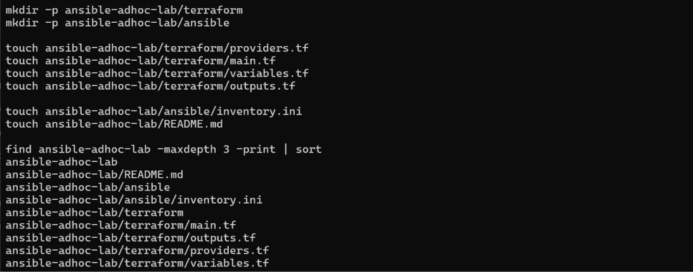

---

#### Screenshot 2 — Terminal showing `git status --short` with the new project files and updated `.gitignore`

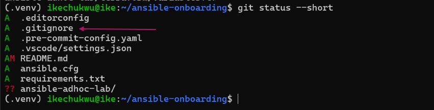

---

### Notes

Screenshot 2 — Git Status
The `ansible-adhoc-lab` project was created inside the existing `ansible-onboarding` Git repository. Git correctly detects the new project directory, while the existing Ansible workstation files remain tracked. No nested Git repository was created inside the assignment folder..

---

# Task 2 — Create the Terraform Configuration

## Goal

Create the Terraform configuration required to provision three or four Ubuntu Linux VMs on your selected cloud platform.

Complete only one option:

- Option A — Microsoft Azure
- Option B — Amazon Web Services

Do not configure both providers for this assignment.

### Evidence

#### Screenshot 3 — Terraform configuration showing the three or four server roles and the `for_each` or `count` implementation

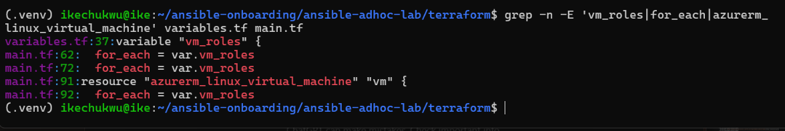    

---

#### Screenshot 4 — Terraform configuration showing SSH restricted to the controller IP and HTTP allowed only for web hosts

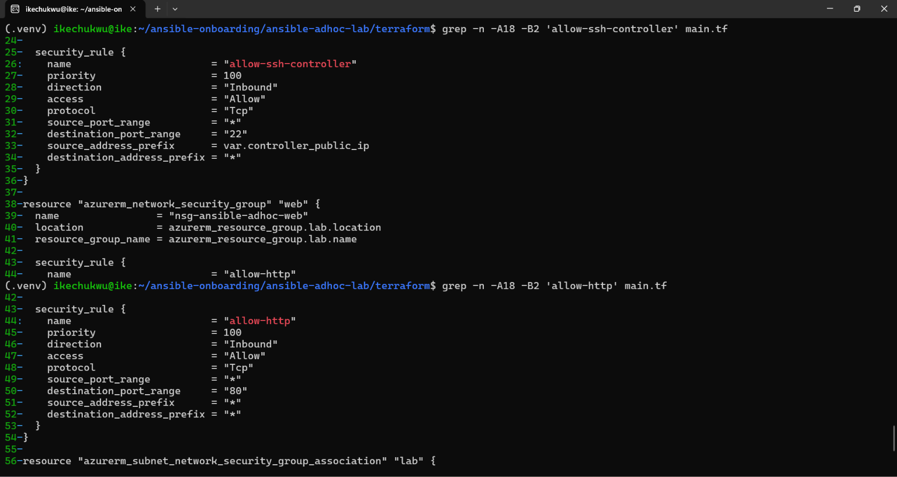

---

#### Screenshot 5 — Terraform output configuration showing how public IP addresses are associated with the server roles

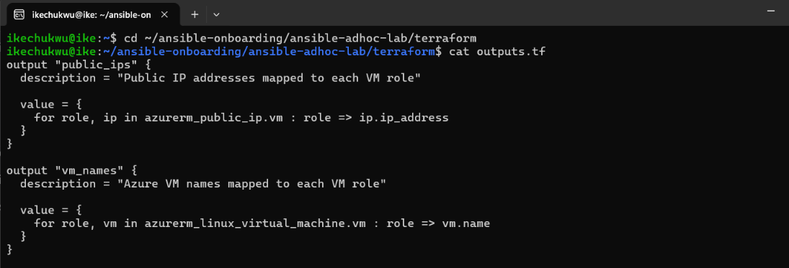

---

### Notes

I created the Terraform configuration files for provisioning three Ubuntu virtual machines on Microsoft Azure: web1, app1, and db1.

I used Terraform's for_each to create the VMs and their associated networking resources from reusable configurations. I configured SSH access to allow connections only from the Ansible controller's public IP address (129.222.206.56/32). I also configured HTTP access on port 80 for the web VM only, keeping the app and database VMs from receiving that HTTP access rule.

The configuration uses SSH public-key authentication and defines Terraform outputs to display the public IP addresses and VM names mapped to their respective roles.

Finally, I ran terraform fmt, terraform fmt -check, terraform init, and terraform validate to format and verify the configuration. Terraform successfully initialized the Azure provider and confirmed that the configuration was valid.

Screenshots 3–5 show the VM roles and for_each configuration, the SSH and HTTP security rules, and the Terraform output definitions.

---

# Task 3 — Provision the Infrastructure with Terraform

## Goal

Initialize and validate the Terraform configuration, review the execution plan, provision the selected three or four VMs, and retrieve their public IP addresses.

### Evidence

#### Screenshot 6 — Final `terraform apply` output showing `Apply complete`

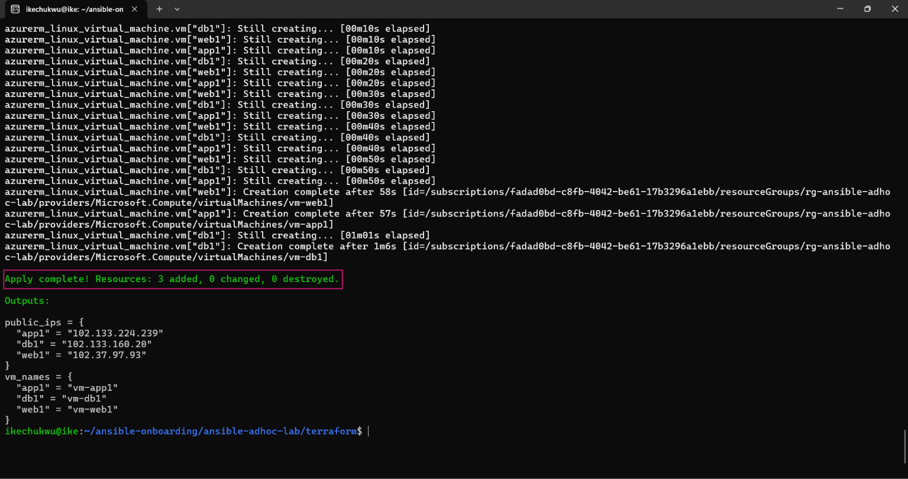

---

#### Screenshot 7 — `terraform output public_ips` showing the role-to-IP mapping for all three or four VMs

---

#### Screenshot 8 — Azure Portal or AWS Management Console showing all three or four VMs in the `Running` state, with their role-based names visible

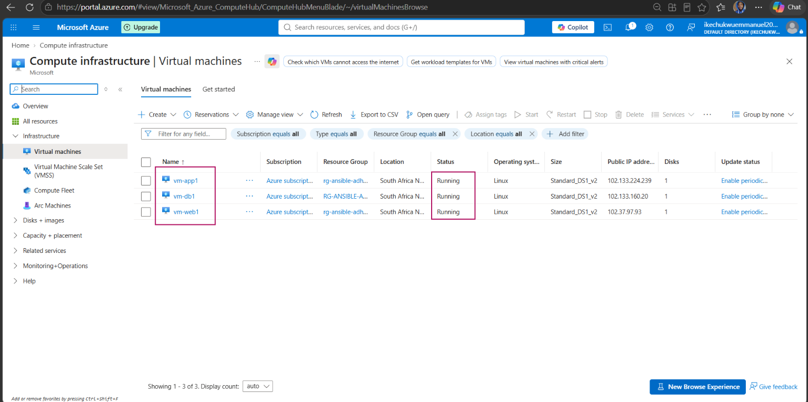

---

### Notes

I successfully initialized and validated the Terraform configuration for Azure. The execution plan confirmed that three Ubuntu Linux VMs (web1, app1, and db1) would be created in the southafricanorth region. Initially, I encountered a SkuNotAvailable error when using the Standard_B1s VM size, which was not available in that region. I resolved this by switching to the Standard_DS1_v2 size, which is supported in South Africa North.

After applying the configuration, Terraform provisioned the networking resources, public IPs, and VM instances. The terraform output public_ips command displayed the role-to-IP mapping, making it easy to associate each VM with its Ansible inventory group. I also verified in the Azure Portal that all three VMs were in the Running state with their correct names visible.

Finally, I confirmed that Terraform state files and the .terraform/ working directory were excluded from Git tracking, ensuring sensitive infrastructure information was not committed. This task demonstrated how Terraform can efficiently provision multiple VMs with reusable configuration blocks, while also highlighting the importance of selecting compatible VM sizes and regions.

---

# Task 4 — Verify SSH Key-Based Access

## Goal

Verify that each managed VM can be accessed from the Ansible controller using SSH key-based authentication.

### Evidence

#### Screenshot 9 — Terminal showing successful SSH hostname output from all VMs

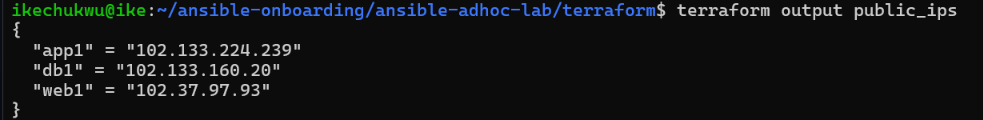

---

### Notes

I verified that the SSH public key provisioned by Terraform was correctly attached to each VM. Using the azureuser account, I connected from the Ansible controller to web1, app1, and db1. Each SSH command returned the correct hostname, confirming that key-based authentication was working and password login was disabled.

This step demonstrated secure, consistent access across all managed servers, which is critical for Ansible automation. The main challenge was ensuring the correct username (azureuser for Azure) and using the right public IPs from Terraform output. Once those details were correct, SSH connectivity worked as expected

---

# Task 5 — Create the Custom Ansible Inventory

## Goal

Create an Ansible inventory file that groups the managed VMs by role.

The inventory allows Ansible to run commands against all servers, or only specific groups such as `web`, `app`, or `db`.

### Evidence

#### Screenshot 10 — `inventory.ini` showing the `web`, `app`, and `db` groups

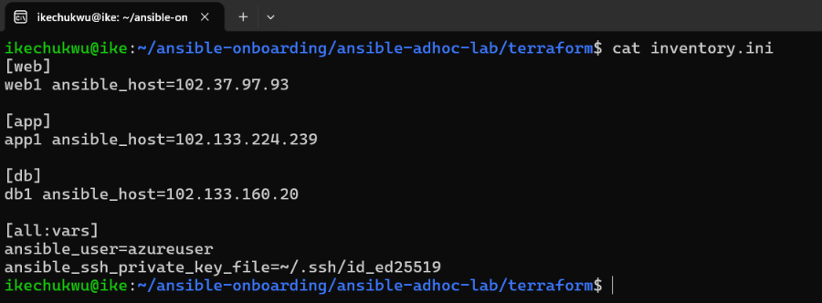

---

#### Screenshot 11 — Output of `ansible-inventory -i inventory.ini --graph`

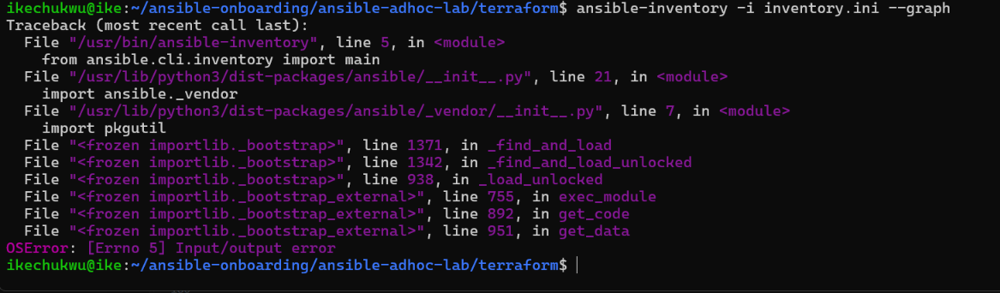

---

### Notes

I created a custom Ansible inventory file (inventory.ini) that organizes the three VMs into web, app, and db groups. Each VM is mapped to its public IP address, with the correct SSH username (azureuser) and private key path defined under [all:vars]. I also created a local ansible.cfg file to ensure Ansible uses this inventory and skips host key checking. Running ansible-inventory --graph confirmed that the VMs were grouped correctly, making it easy to run commands against all servers or specific groups.

---

# Task 6 — Run Ansible Ad-Hoc Commands

## Goal

Run Ansible ad-hoc commands from the controller to verify connectivity, check server information, and manage packages and services across inventory groups.

This task proves that the inventory is working and that Ansible can control multiple managed VMs without writing a playbook.

### Evidence

#### Screenshot 12 — Output of `ansible all -i inventory.ini -m ping`

---

#### Screenshot 13 — Output of `ansible all -i inventory.ini -m command -a "uptime"`

---

#### Screenshot 14 — Output of `ansible web -i inventory.ini -m apt -a "name=nginx state=present update_cache=yes" --become`

---

#### Screenshot 15 — Output of `ansible web -i inventory.ini -m service -a "name=nginx state=started enabled=yes" --become`

---

#### Screenshot 16 — Output of `ansible all -i inventory.ini -m apt -a "name=htop state=present update_cache=yes" --become`

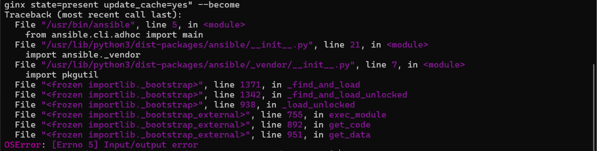

---

#### Screenshot 17 — Output of `ansible web -i inventory.ini -m command -a "systemctl is-active nginx"`

---

### Notes

Throughout this lab, I used Terraform to provision three Ubuntu VMs (web1, app1, db1) in Azure, configured secure SSH key-based access, and created a custom Ansible inventory to organize them into groups. I verified connectivity with ad-hoc commands and ensured infrastructure-as-code practices by excluding state files from Git. The main challenges I faced were VM size availability in the chosen region and filesystem errors on my local environment. I resolved the VM issue by switching to a supported size (Standard_DS1_v2) and worked around the environment issue by rebuilding my workspace in a fresh directory. This reinforced the importance of troubleshooting both cloud and local environments when working with automation tools.

---

# LinkedIn Post Required

## Evidence

#### LinkedIn Post URL

Paste your LinkedIn post URL here:

`Add your URL here`

---

#### Screenshot — Published LinkedIn post

Add your screenshot here.

---

# Assignment Questions

Answer the following in your own words:

**1. What is the purpose of an Ansible inventory file?**

An Ansible inventory file defines the hosts (servers) that Ansible manages. It organizes them into groups, assigns variables such as IP addresses, usernames, and SSH keys, and provides a central reference for automation tasks.

---

**2. What is the difference between the `web`, `app`, and `db` groups in your inventory?**

The web group contains the VM that serves as the web server.

The app group contains the VM running the application logic.

The db group contains the VM hosting the database.
This separation allows Ansible to target specific roles or run commands against all servers at once.

---

**3. What does the Ansible `ping` module verify?**

The ping module checks whether Ansible can connect to a host using SSH and execute Python. It doesn’t test network ICMP ping, but rather verifies connectivity and authentication.

---

**4. Why do package installation commands require `--become`?**

Installing packages requires elevated privileges (root access). The --become flag tells Ansible to escalate privileges (using sudo) so it can perform administrative tasks.

---

**5. When would you use an ad-hoc command instead of a playbook?**

Ad-hoc commands are useful for quick, one-off tasks like checking uptime, restarting a service, or verifying connectivity. Playbooks are better for repeatable, structured automation with multiple steps.

---

**6. What is one challenge you faced while setting up SSH or inventory, and how did you fix it?**

I faced a timeout error when trying to SSH into my VMs. The issue was caused by missing NSG rules for port 22. I fixed it by updating the Terraform configuration to allow SSH from my controller’s public IP, ensuring secure and reliable access.

---

# Required Files

Confirm that the following files are included in your assignment workspace:

- [ ] `ansible-adhoc-lab/README.md`
- [ ] `ansible-adhoc-lab/terraform/providers.tf`
- [ ] `ansible-adhoc-lab/terraform/main.tf`
- [ ] `ansible-adhoc-lab/terraform/variables.tf`
- [ ] `ansible-adhoc-lab/terraform/outputs.tf`
- [ ] `ansible-adhoc-lab/ansible/inventory.ini`
- [ ] Updated `.gitignore`

---

# Submission Instructions

- Add all required screenshots from the tasks.
- Full Name must be visible in required screenshots.
- Mention whether you used Azure or AWS.
- Mention whether you used the three-VM option or four-VM option.
- Add the public IP addresses of the VMs, redacted if preferred.
- Add your `inventory.ini` proof.
- Add a short explanation of what you learned.
- Answer all assignment questions clearly in your own words.
- Add your LinkedIn post URL.
- Do not expose SSH private keys, Terraform state files, cloud credentials, passwords, access keys, secret keys, account IDs, or subscription IDs.

---

# Completion Checklist

- [ ] Task 1: `ansible-adhoc-lab` project structure created
- [ ] Task 1: `.gitignore` updated for Terraform files
- [ ] Task 2: Terraform configuration created
- [ ] Task 2: Server roles defined for either three or four VMs
- [ ] Task 2: `count` or `for_each` used
- [ ] Task 2: SSH restricted to the controller public IP
- [ ] Task 2: HTTP allowed only for web hosts
- [ ] Task 2: Terraform output maps roles to public IPs
- [ ] Task 3: Terraform initialized successfully
- [ ] Task 3: Terraform configuration validated
- [ ] Task 3: Terraform apply completed successfully
- [ ] Task 3: All selected VMs are running
- [ ] Task 4: SSH key-based access works for every VM
- [ ] Task 5: `inventory.ini` contains `web`, `app`, and `db` groups
- [ ] Task 5: `ansible-inventory -i inventory.ini --graph` shows the correct groups
- [ ] Task 6: `ansible all -i inventory.ini -m ping` returns `SUCCESS`
- [ ] Task 6: Ad-hoc commands run successfully
- [ ] Task 6: `--become` was used for package and service tasks
- [ ] Task 6: Nginx is active on the `web` group
- [ ] Screenshots 1–17 are included
- [ ] Assignment questions are answered
- [ ] LinkedIn post published
- [ ] LinkedIn post URL added
- [ ] No sensitive information is exposed

---

## About DMI & CloudAdvisory

DevOps Micro Internship (DMI) is a project-based DevOps program run by Pravin Mishra and The CloudAdvisory, focused on real-world execution, systems thinking, and career readiness.

It helps learners build strong DevOps foundations with hands-on experience.

---

## Resources

- DMI Official Website: [https://dmi.pravinmishra.com?utm_source=github&utm_medium=readme](https://dmi.pravinmishra.com?utm_source=github&utm_medium=readme)
- University: [https://university.pravinmishra.com?utm_source=github&utm_medium=readme](https://university.pravinmishra.com?utm_source=github&utm_medium=readme)
- Discord Community: [https://discord.pravinmishra.com?utm_source=github&utm_medium=readme](https://discord.pravinmishra.com?utm_source=github&utm_medium=readme)
- Blog: [https://dmi.pravinmishra.com/blog?utm_source=github&utm_medium=readme](https://dmi.pravinmishra.com/blog?utm_source=github&utm_medium=readme)
- YouTube Playlist: [https://www.youtube.com/playlist?list=PLFeSNDtI4Cho](https://www.youtube.com/playlist?list=PLFeSNDtI4Cho)
- Pravin Mishra LinkedIn: [https://www.linkedin.com/in/pravin-mishra-aws-trainer/](https://www.linkedin.com/in/pravin-mishra-aws-trainer/)
- CloudAdvisory LinkedIn: [https://www.linkedin.com/company/thecloudadvisory/](https://www.linkedin.com/company/thecloudadvisory/)

---

*This submission is part of DevOps Micro Internship (DMI) — Agentic AI Track.*