# Assignment 03 — Deploy a Static Website to Multiple Servers Using a Multi-Play Ansible Playbook

Part of the DevOps Micro Internship (DMI) with Agentic AI

---

## Student Details

**Full Name:** Ikechukwu Emmanuel 
**Cloud Platform Used:** Azure  
**Server 1 URL:** `http://<SERVER_1_PUBLIC_IP>`  
**Server 2 URL:** `http://<SERVER_2_PUBLIC_IP>`

---

## Purpose

In this assignment, you will create a multi-play Ansible playbook to install Nginx, deploy a static website to two Ubuntu servers, and verify that the website is accessible from both servers.

You may use either AWS EC2 instances or Azure Virtual Machines as your managed servers.

---

# Task 1 — Create the Project Structure

## Goal

Create the required folders and files for the Ansible project.

## Evidence

### Screenshot 1 — Terminal or VS Code showing the complete `static-web` project structure

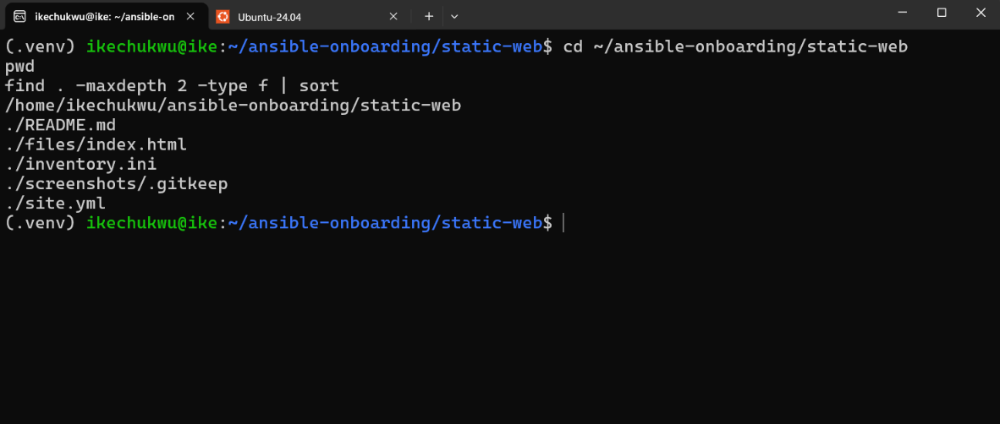

---

# Task 2 — Configure the Ansible Inventory

## Goal

Add both Ubuntu servers to the Ansible inventory.

## Evidence

### Screenshot 2 — Output of `ansible-inventory -i inventory.ini --graph` showing `web1` and `web2`

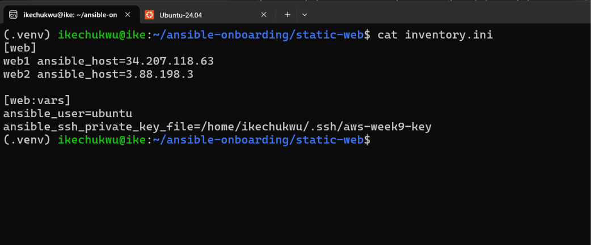

---

## Configuration File

Copy and paste the complete contents of your `inventory.ini` file below:

```ini
[web]
web1 ansible_host=34.207.118.63
web2 ansible_host=3.88.198.3

[web:vars]
ansible_user=ubuntu
ansible_ssh_private_key_file=/home/ikechukwu/.ssh/aws-week9-key
```

---

# Task 3 — Verify Ansible Connectivity

## Goal

Confirm that the Ansible controller can connect to both servers.

## Evidence

### Screenshot 3 — Ansible ping output showing `SUCCESS` and `pong` for both servers

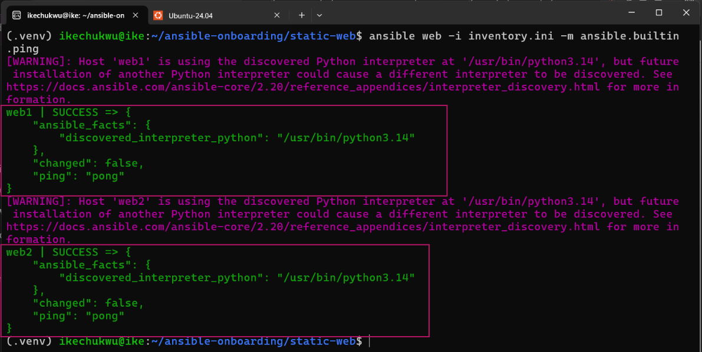

---

# Task 4 — Download and Personalize the Static Website

## Goal

Download `index.html` to the Ansible controller and personalize the website with your full name.

## Evidence

### Screenshot 4 — Edited `files/index.html` showing the footer line with your full name

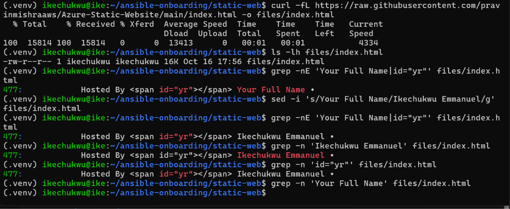

---

# Task 5 — Create the Multi-Play Ansible Playbook

## Goal

Create a single Ansible playbook containing separate plays for installation, deployment, and verification.

## Configuration File

Copy and paste the complete contents of your `site.yml` file below:

```yaml
---
- name: Install and start Nginx on web servers
  hosts: web
  become: true
  tasks:
    - name: Install Nginx
      ansible.builtin.apt:
        name: nginx
        state: present
        update_cache: true

    - name: Ensure Nginx is started and enabled
      ansible.builtin.service:
        name: nginx
        state: started
        enabled: true

- name: Deploy the static website
  hosts: web
  become: true
  tasks:
    - name: Copy website to the Nginx web root
      ansible.builtin.copy:
        src: files/index.html
        dest: /var/www/html/index.html
        owner: www-data
        group: www-data
        mode: "0644"
      notify: Reload Nginx

  handlers:
    - name: Reload Nginx
      ansible.builtin.service:
        name: nginx
        state: reloaded

- name: Verify websites return HTTP 200
  hosts: localhost
  connection: local
  gather_facts: false
  tasks:
    - name: Check each web server
      ansible.builtin.uri:
        url: "http://{{ hostvars[item].ansible_host }}"
        method: GET
        status_code: 200
        return_content: false
      loop: "{{ groups['web'] }}"
      register: website_checks

    - name: Confirm every website returned HTTP 200
      ansible.builtin.assert:
        that:
          - item.status == 200
        success_msg: "{{ item.item }} returned HTTP 200"
        fail_msg: "{{ item.item }} did not return HTTP 200"
      loop: "{{ website_checks.results }}"
```

---

# Task 6 — Validate the Playbook Syntax

## Goal

Check the playbook for YAML or Ansible syntax errors before running it.

## Evidence

### Screenshot 5 — Successful syntax-check output showing `playbook: site.yml`

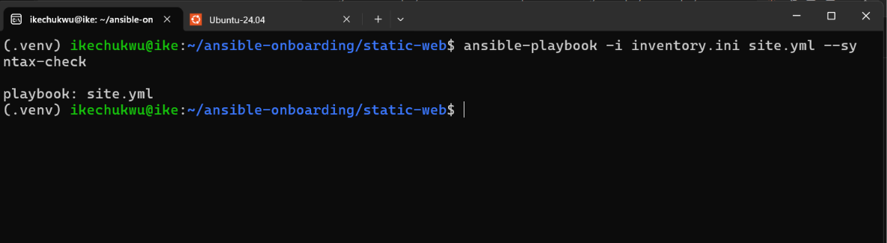

---

# Task 7 — Run the Multi-Play Playbook

## Goal

Install Nginx, deploy the website, and verify both servers in one playbook run.

## Evidence

### Screenshot 6 — Play 3 verification showing HTTP `200` for both servers

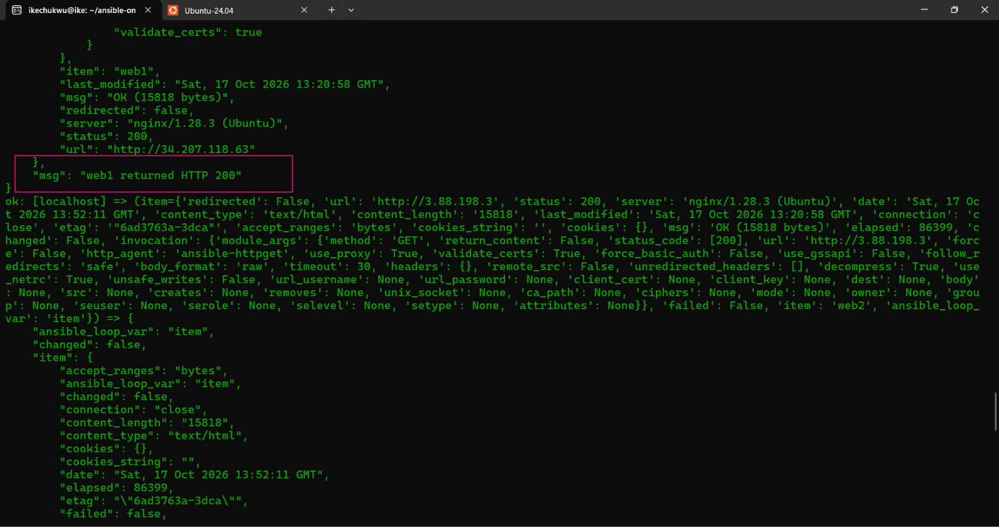

---

### Screenshot 7 — Final play recap showing `unreachable=0` and `failed=0` for `web1`, `web2`, and `localhost`

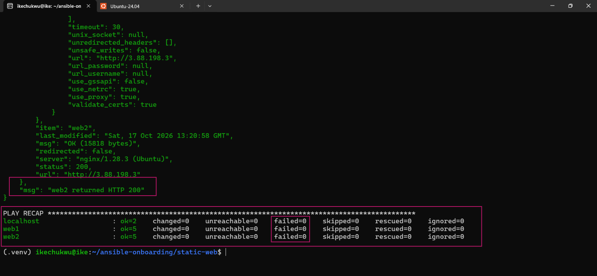

---

# Task 8 — Verify Idempotency

## Goal

Run the playbook again and confirm that it does not make unnecessary changes.

## Evidence

### Screenshot 8 — Second playbook run showing the play recap with `changed=0`, `unreachable=0`, and `failed=0` for both web servers

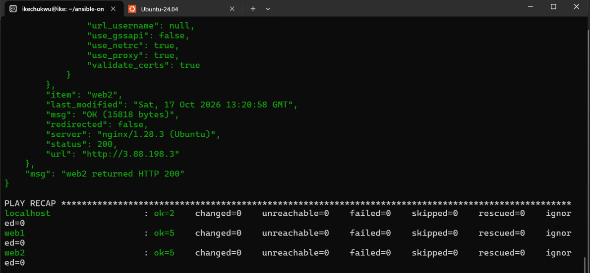

---

# Task 9 — Test Both Websites Manually

## Goal

Confirm that the static website is accessible from both public IP addresses.

## Evidence

### Screenshot 9 — `curl -I` output showing HTTP `200 OK` from both servers

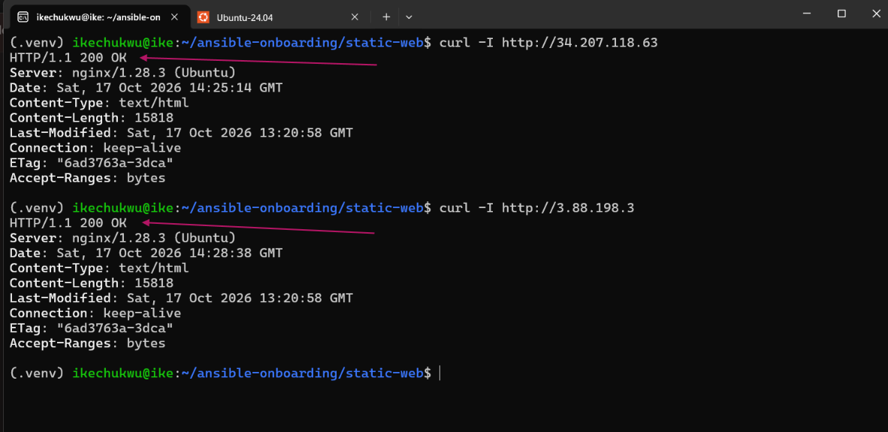

---

### Screenshot 10 — Browser showing the website from Server 1 with the public IP and your full name visible

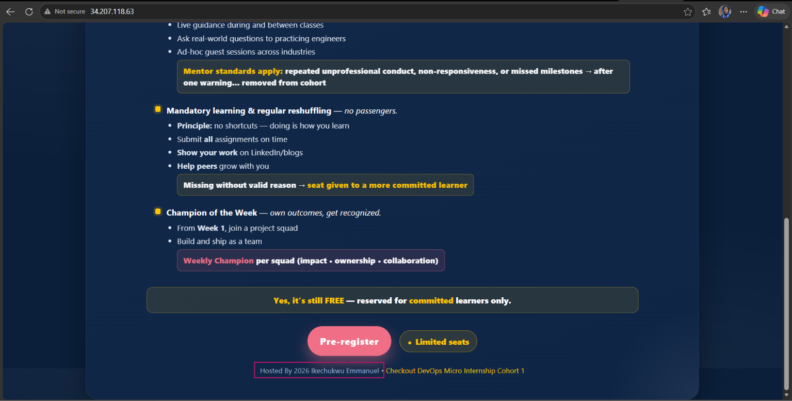

---

### Screenshot 11 — Browser showing the website from Server 2 with the public IP and your full name visible

.

---

## Website URLs

Add both deployed website URLs below:

```text
Server 1: http://34.207.118.63
Server 2: http://3.88.198.3
```

---

# Task 10 — Complete the Project README

## Goal

Document how the project works and record what you learned.

## README Content

Copy and paste the complete contents of your `README.md` file below:

```markdown

## Project Overview

This project uses Ansible to deploy a static website to two Ubuntu EC2 instances. A multi-play Ansible playbook installs and starts Nginx, copies the website to the web root, and verifies that both websites return HTTP 200.

## Project Structure

```text
static-web/
├── inventory.ini
├── site.yml
├── README.md
├── files/
│   └── index.html
└── screenshots/
    ├── 01.png
    ├── 02.png
    ├── 03.png
    ├── 04.png
    ├── 05.png
    ├── 06.png
    ├── 07.png
    ├── 08.png
    ├── 09.png
    ├── 10.png
    └── 11.png
```

## Prerequisites

- Ansible installed on the control machine.
- Two running Ubuntu EC2 instances.
- SSH access to both instances.
- A valid private SSH key with appropriate permissions.
- Security group rules allowing SSH (TCP 22) from the controller's current public IP and HTTP (TCP 80) from the internet.
- Python available on the managed hosts.

## Inventory Configuration

The `inventory.ini` file defines the two managed web servers:

```ini
[web]
web1 ansible_host=34.207.118.63
web2 ansible_host=3.88.198.3

[web:vars]
ansible_user=ubuntu
ansible_ssh_private_key_file=/home/ikechukwu/.ssh/aws-week9-key
```

The private key remains on the control machine and must not be committed to the repository.

## Playbook Overview

The `site.yml` file contains three plays:

1. **Install and start Nginx:** Uses Ansible's APT and service modules to install Nginx and ensure the service is running and enabled.
2. **Deploy the website:** Copies `files/index.html` to `/var/www/html/index.html`, sets the owner and group to `www-data`, applies file permissions `0644`, and reloads Nginx through a handler when the file changes.
3. **Verify both websites:** Runs locally on the control machine, sends HTTP requests to both servers, expects status code 200, and asserts that each check succeeds.

## How to Run the Project

Run these commands from the project directory:

### 1. Check connectivity

```bash
ansible web -i inventory.ini -m ping
```

### 2. Validate playbook syntax

```bash
ansible-playbook -i inventory.ini site.yml --syntax-check
```

### 3. Deploy and verify

```bash
ansible-playbook -i inventory.ini site.yml --become
```

### 4. Verify HTTP response headers

```bash
curl -I http://34.207.118.63
curl -I http://3.88.198.3
```

## Verification Results

The deployment was verified by:

- Confirming Ansible connectivity to both managed hosts.
- Validating the playbook syntax.
- Installing and starting Nginx on both servers.
- Deploying the customized static website to both web roots.
- Confirming that both HTTP checks returned status code 200.
- Re-running the playbook to test idempotency.
- Checking the response headers and opening both websites in a browser.

The successful playbook recap showed zero failed and unreachable hosts. The second run reported `changed=0` on both web servers.

## Idempotency

Ansible idempotency means that running the same playbook repeatedly should not make unnecessary changes when the desired state has already been achieved. On the second run, both web servers reported `changed=0`, confirming that the deployment was idempotent for the tested state.

## Lessons Learned

This assignment provided practical experience with Ansible inventories, SSH connectivity, multi-play playbooks, privilege escalation, Nginx configuration, file deployment, handlers, HTTP verification, assertions, and idempotency.

It also demonstrated the importance of checking SSH security group rules when a controller's public IP changes and of running HTTP verification locally without unnecessary privilege escalation.

## Security Notes

- Keep private SSH keys outside the project repository.
- Restrict SSH access to trusted source IP addresses.
- Allow HTTP access as required for a public website.
- Do not publish credentials or private keys in screenshots or documentation.
- Review cloud resources and costs after completing the assignment.

## Screenshots

The `screenshots/` directory contains evidence of the project structure, inventory, connectivity, customized website, syntax validation, successful deployment, playbook recap, idempotency, HTTP response headers, and browser verification of both servers.

## Conclusion

The static website was deployed to two Ubuntu EC2 instances using a multi-play Ansible playbook. Both servers returned HTTP 200, and a subsequent playbook run reported no changes on either managed host.

---

# LinkedIn Post Required

## Evidence

### LinkedIn Post URL

Paste your LinkedIn post URL here:

`https://lnkd.in/p/ds6zeYjY`

---

## Screenshot — Published LinkedIn post

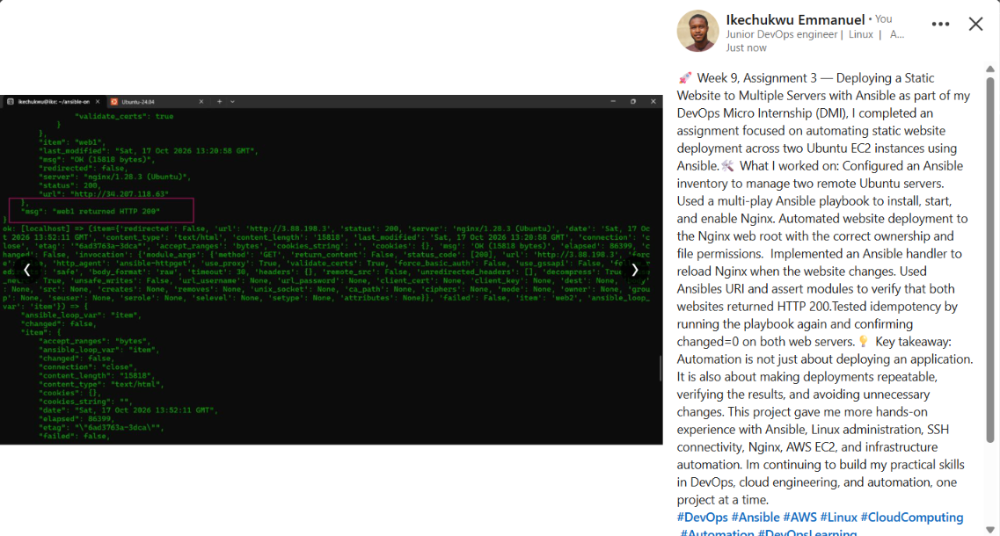

---

# Assignment Questions

Answer the following in your own words:

**1. What issue did you face while completing this assignment, and how did you fix it?**

I encountered an SSH connectivity issue when Ansible attempted to connect to the two Ubuntu EC2 instances. The connection timed out because the security group's SSH inbound rule was configured with an outdated public IP address. I resolved this by updating the inbound SSH rule to allow connections from my current public IP address. After updating the rule, I successfully tested connectivity to both servers using Ansible's ping module.

I also encountered a privilege-escalation issue during the HTTP verification play. The local verification task attempted to use sudo, which required interactive authentication. I resolved this by setting become: false in the localhost verification play because elevated privileges were not required to send HTTP requests to the web servers.

---

**2. What did you learn from this assignment?**

I learned how to use Ansible to automate the deployment of a static website to multiple Ubuntu servers. I gained practical experience configuring an inventory, establishing SSH connectivity, installing and managing Nginx, copying website files with the correct ownership and permissions, and using handlers to reload services when changes occur.

I also learned how to validate playbook syntax, verify HTTP responses using Ansible's URI module and assertions, and test idempotency by running the same playbook more than once. The assignment helped me understand how automation improves consistency, repeatability, and reliability in DevOps workflows.

---

**3. Why is it useful to split installation, deployment, and verification into separate plays?**

Separating installation, deployment, and verification into different plays makes the playbook easier to understand, maintain, troubleshoot, and reuse.

The first play installs Nginx and ensures that the service is running and enabled on both web servers. The second play deploys the website files and reloads Nginx when the files change. The third play runs on the control machine and checks whether both websites return HTTP 200.

This separation gives each play a clear responsibility. If deployment fails, I can identify the relevant stage more easily. It also allows verification to be performed independently of the tasks that modify the web servers.

---

**4. What is one benefit of using the Ansible `copy` module instead of cloning the website directly from Git on every managed server?**

One benefit of using the copy module is that it deploys a specific local file directly to the destination server without requiring Git to be installed on the managed hosts or requiring them to clone a repository.

In this assignment, Ansible copies files/index.html to /var/www/html/index.html and sets the owner, group, and file permissions. This provides a straightforward way to deploy a prepared website file consistently across both servers.

---

**5. What does idempotency mean in this assignment?**

Idempotency means that repeatedly running an Ansible playbook against a system that is already in the desired state should not make unnecessary changes.

I tested idempotency by running the deployment playbook a second time after the initial deployment had succeeded. The second run reported changed=0 for both web1 and web2, indicating that Ansible did not need to make further changes to the managed hosts. Both servers also reported zero failed and unreachable tasks.

---

**6. What does the Ansible `uri` module verify in Play 3?**

The ansible. builtin. uri module sends an HTTP GET request to each web server using the server's public IP address. The task specifies status_code: 200, so the request is considered successful when the server returns HTTP status code 200.

The play loops through the hosts in groups['web'] and obtains each server's address from hostvars[item]. ansible_host. It registers the results and uses the ansible. builtin. assert module to confirm that each response has a status of 200.

This verifies that both web servers are responding successfully over HTTP. It provides an automated check that the websites are reachable, although an HTTP 200 response alone does not guarantee that every part of the website's content is correct.

---

# Required Files

Confirm that the following files are included in your assignment folder:

- [ ] `inventory.ini`
- [ ] `site.yml`
- [ ] `files/index.html`
- [ ] `README.md`

---

# Submission Instructions

- Add all required screenshots in the correct order.
- Full Name must be visible in required screenshots.
- Include both deployed website URLs.
- Paste `inventory.ini`, `site.yml`, and `README.md` as editable text.
- Answer all assignment questions clearly in your own words.
- Add your LinkedIn post URL.
- Do not expose SSH private keys, passwords, cloud account IDs, or other sensitive information.

---

# Completion Checklist

- [ ] Task 1: `static-web` folder structure is complete
- [ ] Task 2: Both servers are listed under the `[web]` group in `inventory.ini`
- [ ] Task 2: Inventory graph shows `web1` and `web2`
- [ ] Task 3: Ansible ping returns `SUCCESS` and `pong` for both servers
- [ ] Task 4: `files/index.html` contains your full name
- [ ] Task 5: `site.yml` contains three separate plays
- [ ] Task 5: Play 1 installs, starts, and enables Nginx
- [ ] Task 5: Play 2 deploys `index.html` using the `copy` module
- [ ] Task 5: Nginx reload handler is included
- [ ] Task 5: Play 3 verifies both web servers from the controller
- [ ] Task 6: Playbook syntax check passes
- [ ] Task 7: First playbook run completes with `unreachable=0` and `failed=0`
- [ ] Task 7: URI verification returns HTTP `200` for both servers
- [ ] Task 8: Second playbook run demonstrates idempotency
- [ ] Task 8: Second run shows `changed=0` for both web servers
- [ ] Task 9: Both `curl -I` commands return HTTP `200 OK`
- [ ] Task 9: Website loads from Server 1
- [ ] Task 9: Website loads from Server 2
- [ ] Task 9: Full name is visible on both deployed websites
- [ ] Task 10: `README.md` contains all required explanations
- [ ] Screenshots 1–11 are included
- [ ] `inventory.ini`, `site.yml`, and `README.md` are pasted as editable text
- [ ] Both website URLs are included
- [ ] Assignment questions are answered
- [ ] LinkedIn post published
- [ ] LinkedIn post URL added
- [ ] No sensitive information is exposed

---

## About DMI & CloudAdvisory

DevOps Micro Internship (DMI) is a project-based DevOps program run by Pravin Mishra and The CloudAdvisory, focused on real-world execution, systems thinking, and career readiness.

It helps learners build strong DevOps foundations with hands-on experience.

---

## Resources

- DMI Official Website: [https://dmi.pravinmishra.com?utm_source=github&utm_medium=readme](https://dmi.pravinmishra.com?utm_source=github&utm_medium=readme)
- University: [https://university.pravinmishra.com?utm_source=github&utm_medium=readme](https://university.pravinmishra.com?utm_source=github&utm_medium=readme)
- Discord Community: [https://discord.pravinmishra.com?utm_source=github&utm_medium=readme](https://discord.pravinmishra.com?utm_source=github&utm_medium=readme)
- Blog: [https://dmi.pravinmishra.com/blog?utm_source=github&utm_medium=readme](https://dmi.pravinmishra.com/blog?utm_source=github&utm_medium=readme)
- YouTube Playlist: [https://www.youtube.com/playlist?list=PLFeSNDtI4Cho](https://www.youtube.com/playlist?list=PLFeSNDtI4Cho)
- Pravin Mishra LinkedIn: [https://www.linkedin.com/in/pravin-mishra-aws-trainer/](https://www.linkedin.com/in/pravin-mishra-aws-trainer/)
- CloudAdvisory LinkedIn: [https://www.linkedin.com/company/thecloudadvisory/](https://www.linkedin.com/company/thecloudadvisory/)

---

*This submission is part of DevOps Micro Internship (DMI) — Agentic AI Track.*